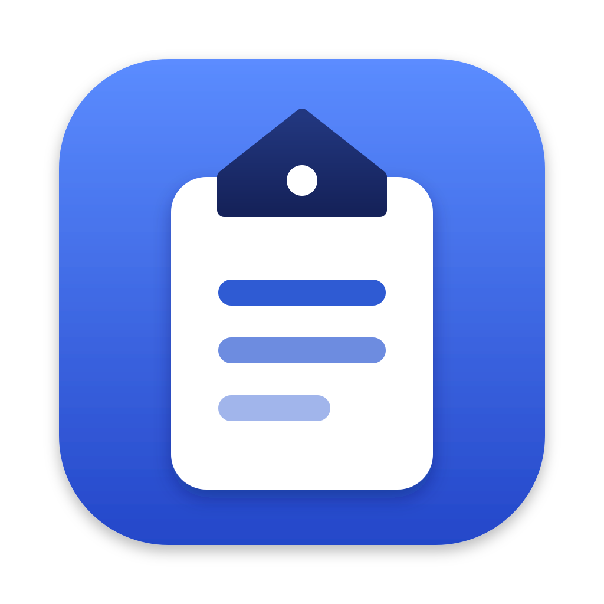

<p align="center">
  
</p>

<h1 align="center">Clipstead</h1>

<p align="center">
  Your own cloud clipboard. Copy on your Mac, paste from any device, on a server you run yourself.
  <br><br>
  <a href="https://github.com/t0uh33d/clipstead/releases/latest/download/Clipstead.dmg"><b>Download for macOS</b></a>
  ·
  <a href="docs/self-hosting.md">Self-hosting guide</a>
  ·
  <a href="https://github.com/t0uh33d/clipstead/releases">Releases</a>
</p>

A native macOS menu bar app sends what you copy (text with its formatting, and images) to a server **you** run on your
own Cloudflare account. A web app lets you search that history and copy from it on any device.

- **Self-hosted**: one Cloudflare Worker and one D1 database in your account. No account with the project author,
  no third-party sign-in, no analytics. The Free plan is enough for personal use.
- **Multi-user, isolated**: each instance supports many accounts, and no user can reach another's clipboard,
  devices or sessions. Registration is closed, invite-only or open.
- **Keeps what you copied**: plain text, formatting (bold, links, lists, from browsers, Pages, Word or TextEdit), and
  images such as screenshots. Copying from the web app puts the formatting or the image back on your clipboard.
- **Private by default**: clipboard history expires after 6 hours (adjustable). Copies that password managers
  mark as confidential, and apps you exclude, are skipped. Nothing syncs until you pair a Mac and consent.
- **Native and light**: Swift and SwiftUI, a menu bar icon that shows when sync is on, one-click pause. Device
  tokens live in the Keychain.

> Clipboard content is stored **unencrypted** in your D1 database. You, anyone with access to your Cloudflare
> account, and Cloudflare can read it. Clipstead does not offer end-to-end encryption. See
> [docs/security.md](docs/security.md).

## How it works

1. Deploy the Worker (API + web app) and create the administrator with a one-time setup token.
2. In the web app, choose **Devices → Add a Mac** to get a pairing code.
3. Enter the server address and code in the Mac app, then approve the Mac in the browser after checking its details.
4. Turn on sync. Text, formatting and images you copy are uploaded. Open the web app anywhere to search and click
   to copy.
5. Revoke devices, sign out sessions, delete entries or your account at any time.

## Install the Mac app

Download **[Clipstead.dmg](https://github.com/t0uh33d/clipstead/releases/latest/download/Clipstead.dmg)** (macOS 14 or
later, Apple silicon and Intel), open it and drag Clipstead to Applications. The app is not notarized by Apple yet, so
the first time you open it macOS blocks it: open **System Settings → Privacy & Security** and click **Open Anyway**.
To build it yourself instead: `cd apps/macos && ./scripts/build-app.sh`.

## Deploy your server

```sh
git clone https://github.com/t0uh33d/clipstead.git && cd clipstead/worker
npm ci && npx wrangler login
npx wrangler d1 create clipstead                       # put the printed database_id in wrangler.jsonc
npx wrangler d1 migrations apply clipstead --remote
npx wrangler secret put SETUP_TOKEN                    # e.g. the output of: openssl rand -base64 32
npx wrangler deploy                                    # prints https://clipstead.<subdomain>.workers.dev
```

Full instructions, including backups, upgrades, costs and teardown, are in
[docs/self-hosting.md](docs/self-hosting.md).

## Documentation

| Document | For |
| --- | --- |
| [docs/self-hosting.md](docs/self-hosting.md) | Deploying, configuring, backing up and removing an instance |
| [docs/security.md](docs/security.md) | Threat model, mitigations and limitations |
| [docs/architecture.md](docs/architecture.md) | How the pieces fit together |
| [docs/api.md](docs/api.md) | HTTP API reference |
| [docs/development.md](docs/development.md) | Running locally, tests, release checklist |
| [PLAN.md](PLAN.md) | Design decisions and project status |

## Status and limitations

Early (0.1). Tested on macOS 27 with Xcode 26.2, and with Chromium for the web app. Other browsers and older macOS
versions (the minimum is 14) have not been tested yet.

- Files copied in Finder are not synced. Images are limited to 1 MB per item and re-encoded smaller when needed.
- The downloadable app is ad-hoc signed, not notarized, so macOS asks you to approve its first launch.
- No iOS or Windows clients, no two-factor authentication, and no end-to-end encryption.
- App exclusions depend on which app is in front when a copy is noticed, so they are best-effort.

## Contributing and security

See [CONTRIBUTING.md](CONTRIBUTING.md). Report vulnerabilities privately as described in [SECURITY.md](SECURITY.md).

## License

[MIT](LICENSE)
